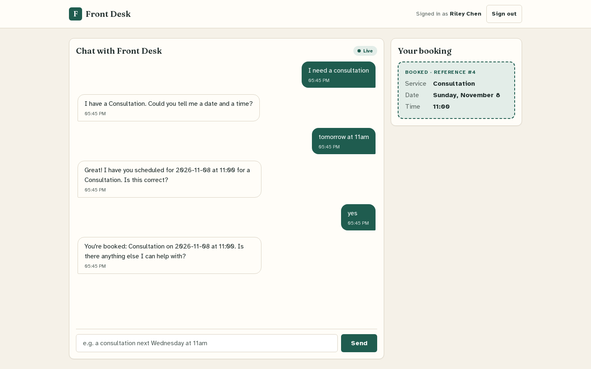
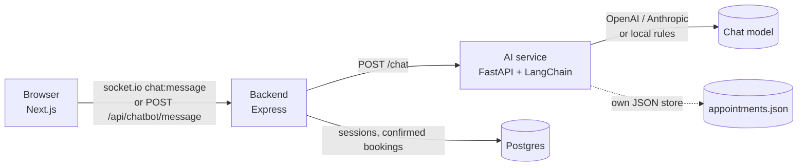
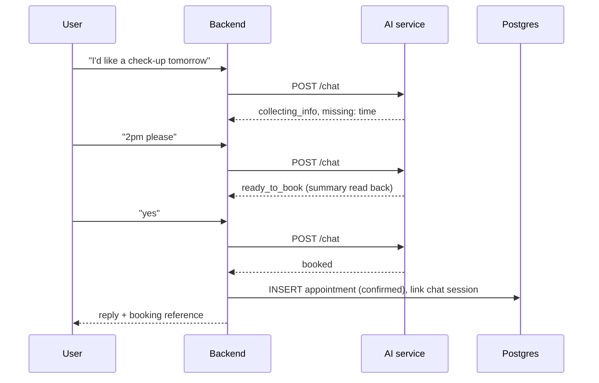
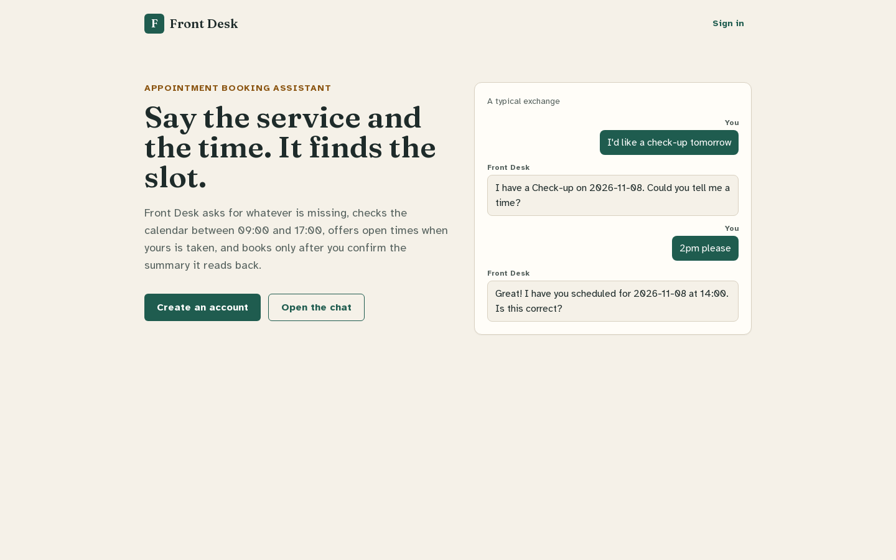
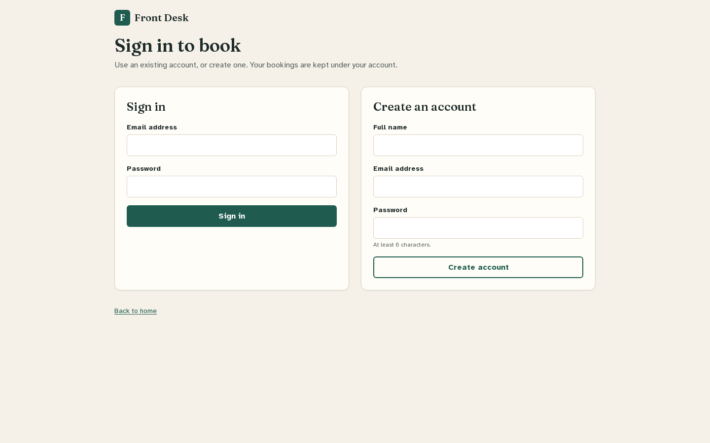
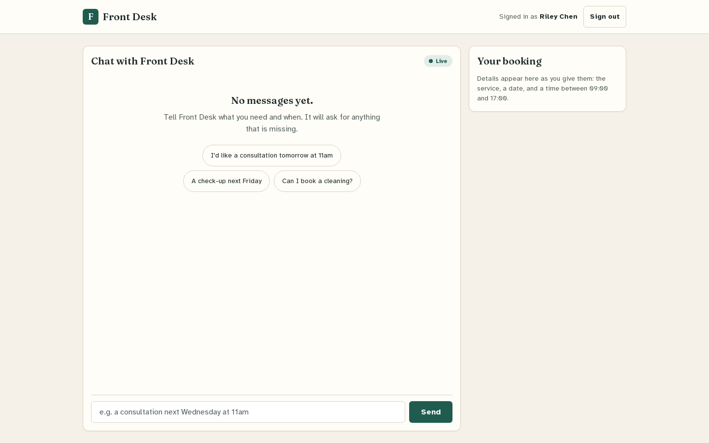
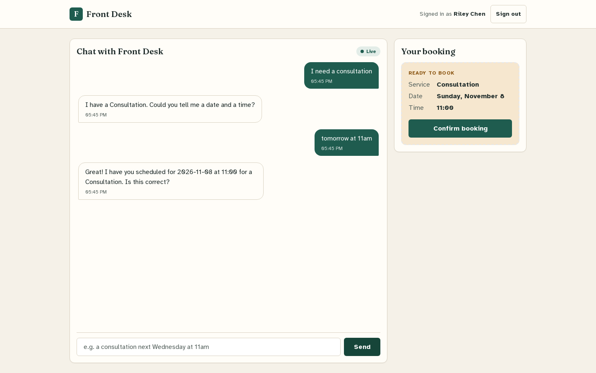
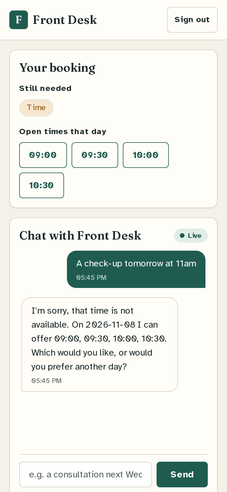

# Front Desk: an appointment booking chatbot

A chat app for booking appointments. You type something like "I'd like a consultation next Wednesday at 11am"; the assistant pulls out the service, date and time, asks for whatever is missing, checks the slot, reads a summary back and books only when you agree to it. Confirmed bookings land in Postgres, and if the time is taken it offers the open times that day.

It runs with no API keys: a rule-based LangChain model stands in for OpenAI or Anthropic, so the whole flow works offline.



## What is in the repository

Everything lives under `TeraLeads/`:

| Service | Stack | Job |
| --- | --- | --- |
| `chatbot-frontend/` | Next.js 16, React 19, Redux Toolkit, Tailwind, socket.io client | Sign-in, the chat, and the booking panel |
| `chatbot-backend/` | Node 22, Express 5, socket.io, PostgreSQL, JWT | Auth, chat transport, chat history, the appointments calendar |
| `chatbot-ai/` | Python 3.12, FastAPI, LangChain | The conversation: slot filling, availability, confirmation |
| Postgres 15 | | `users`, `appointments`, `chat_sessions`, `businesses` |



## Quick start

Needs Docker with Compose.

```bash
cd TeraLeads
cp .env.example .env
docker compose up -d --build
```

- Chat UI: http://localhost:3400
- Backend API: http://localhost:3401 (Swagger UI at `/api-docs`)
- AI service: http://localhost:8400/docs

Create an account on the sign-in page and start typing. Every setting in `.env.example` has a default, so the stack also starts without a `.env`. To use a hosted model, set `OPENAI_API_KEY` or `ANTHROPIC_API_KEY`; `LLM_PROVIDER=auto` picks it up, and `local`, `openai` or `anthropic` forces one.

`docker compose down -v` stops everything and drops the database volume. For hot reload while editing, add the override: `docker compose -f docker-compose.yml -f docker-compose.dev.yml up --build`.

## How a booking goes



Some rules the flow enforces, each covered by tests:

- A "yes" only books when it answers the summary the assistant just read back. "Yes, but make it 3pm" changes the details, so it gets a new summary.
- The slot is checked again at confirmation time, so two people deciding on the same slot cannot both get it.
- After a booking the details are cleared, so a second "yes" does not book twice.
- When a slot is taken, the time is dropped and up to four open times that day are offered. The UI shows them as buttons.
- Dates the model cannot read (or that do not exist, like February 30) count as missing, and the assistant asks again.
- Opening hours are 09:00 to 17:00, and past dates are refused.

## Screenshots

| | |
| --- | --- |
|  |  |
|  |  |

On a phone the booking panel sits above the chat. Here the requested time was taken and the open times are offered:



## API examples

Captured from the Compose stack (`BASE=http://localhost:3401`). Tokens are shortened.

```bash
curl -s -X POST $BASE/api/auth/signup -H 'Content-Type: application/json' \
  -d '{"email":"sam@example.com","password":"demo-pass-1","name":"Sam Rivera"}'
```
```json
{"token":"eyJhbG...hblk","user":{"id":4,"email":"sam@example.com","name":"Sam Rivera"}}
```

```bash
curl -s -X POST $BASE/api/chatbot/message -H "Authorization: Bearer $TOKEN" \
  -H 'Content-Type: application/json' \
  -d '{"sessionId":"session-demo-1","message":"2pm please"}'
```
```json
{
  "message": "Great! I have you scheduled for 2026-11-08 at 14:00 for a Check-up. Is this correct?",
  "sessionId": "session-demo-1",
  "booking": {
    "status": "ready_to_book",
    "missingFields": [],
    "alternatives": [],
    "appointment": {"date": "2026-11-08", "time": "14:00", "type": "Check-up"}
  }
}
```

Replying `"yes"` returns `"status": "booked"` with the appointment's Postgres id, and the booking shows up in the calendar:

```bash
curl -s $BASE/api/appointments -H "Authorization: Bearer $TOKEN"
```
```json
[{"id":4,"user_id":4,"business_id":null,"date":"2026-11-08","time":"14:00:00","duration_minutes":60,
  "service_type":"Check-up","status":"confirmed","notes":null,"created_at":"...","updated_at":"..."}]
```

Other routes: `POST /api/auth/login`, `POST /api/chatbot/token` (15-minute chat token), `GET /api/appointments/availability?date=YYYY-MM-DD`, and `GET/PUT/DELETE /api/appointments/:id`. The AI service exposes `POST /chat` and `GET /health`, which reports the active model provider. Over socket.io the client connects with `auth: { token }`, emits `chat:message` and receives `bot:message` or `chat:error`.

## Running the tests

Each service runs on its own, with no database, AI service or API key. Postgres and the AI service are mocked in the backend tests, and the AI tests use the local model.

```bash
# AI service (Python 3.12): 94 tests
cd TeraLeads/chatbot-ai
pip install -r requirements-dev.txt
pytest
pylint src

# Backend (Node 22): 65 tests
cd TeraLeads/chatbot-backend
npm ci
npm test
npm run lint

# Frontend (Node 22): 57 tests
cd TeraLeads/chatbot-frontend
npm ci
npm test
npm run lint
npx tsc --noEmit
```

The frontend also has Playwright specs (`npm run test:e2e`) that drive the real UI against `npm run dev` and a running backend.

## Design notes

- **The AI service owns the conversation and the backend owns the calendar.** The assistant decides when a booking is confirmed; the backend writes it to `appointments` with an overlap check, so a slot booked through the REST API in the meantime still produces a polite "that time has just been taken" instead of a double booking.
- **Local model behind the same interface.** `LocalChatModel` is a real LangChain `BaseChatModel` with `with_structured_output`, so the flow runs unchanged against it or a hosted model. It never guesses: anything it has no pattern for comes back empty and the assistant asks.
- **Socket first, HTTP fallback.** The UI uses socket.io when it can connect and posts to the REST endpoint otherwise; the status chip says which.
- **Times are business-local.** Nothing is converted between time zones.

## Limitations

- The local model only understands the phrasings it has patterns for (weekdays, "tomorrow", "March 14", "2pm", "14:30", "at 3"). Hosted models were not exercised for this version; the default model names are current but untested here.
- The AI service checks availability against its own JSON record, with 30-minute slots, while Postgres enforces 60-minute overlaps. A clash is caught when the backend writes the booking, not when the assistant offers the time.
- The AI service keeps conversation state in memory and its JSON store on one volume, so it is single-instance.
- The sign-in token lives in `localStorage`.
- Cancelling or rescheduling through chat is recognised but not implemented; use the appointments API.

## License

MIT, see [LICENSE](LICENSE).
