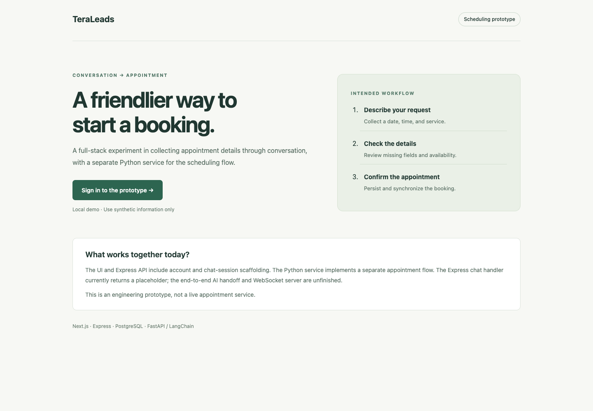
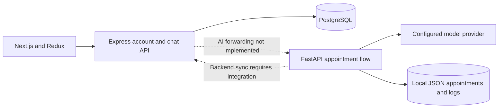

# Appointment Booking Assistant

A full-stack scheduling prototype built around three services: a Next.js account/chat interface, an Express and PostgreSQL API, and a Python/FastAPI appointment conversation flow using LangChain.

**Current status:** the services are not connected into a complete booking product. The Express chat handler returns a placeholder instead of forwarding messages to Python. The client includes Socket.IO support, but the Express server does not implement the matching WebSocket service. The Python flow can collect and confirm appointment details independently; that does not make the browser-to-booking journey complete.



## Service boundaries



The project demonstrates a useful separation between account management and conversation state. It also exposes the integration work a real product needs: one authenticated contract between services, a consistent appointment store, retry/idempotency behavior, and concurrency-safe availability checks. JSON files and in-memory conversation state are development storage, not a multi-worker booking system.

## Explore locally

All application files are inside [`TeraLeads/`](TeraLeads/). Start there, rather than from the repository root.

```sh
cd TeraLeads
cp .env.example .env
# Set a unique JWT_SECRET, a local database password, and provider configuration.
docker compose up --build
```

The supplied Compose file exposes the frontend on localhost:3000, Express on localhost:3001, and FastAPI on localhost:8000. PostgreSQL initialization mounts the supplied schema, indexes, and seed data into a fresh development volume. Existing database volumes are not reinitialized when SQL files change. This Compose setup has not been exercised end to end in this review.

Use synthetic accounts and appointment details. Conversation text can be sent to the configured model provider and stored in local JSON logs. The Python service has no authenticated user boundary; a caller-supplied `user_id` is not authentication. Keep the stack local while integration and access controls are unfinished.

For individual-service development, use the frontend, backend, and AI [service notes](TeraLeads/README.md). The API documentation in [FastAPI's README](TeraLeads/chatbot-ai/README.md) describes that separate service rather than a verified browser workflow.

## What to inspect

| Area | Entry point | What it shows |
| --- | --- | --- |
| Interface | `TeraLeads/chatbot-frontend/src/app` | Account screens, protected routes, chat UI |
| Accounts | `TeraLeads/chatbot-backend/src/services/auth.service.js` | Password hashing and token issuance |
| Chat boundary | `TeraLeads/chatbot-backend/src/services/chatbot.service.js` | Session persistence and the unfinished AI handoff |
| Conversation flow | `TeraLeads/chatbot-ai/src/flows/appointment_flow.py` | Detail collection, confirmation, storage and sync attempt |
| Storage | `TeraLeads/chatbot-ai/src/storage` | JSON persistence used by the AI prototype |

The landing page labels the intended workflow and current integration status. Its workflow panel is explanatory UI, not a transcript or proof that an appointment was created.

## Checks and limitations

Frontend checks run inside `TeraLeads/chatbot-frontend`:

```sh
npm ci --ignore-scripts
npm test -- --runInBand
npm run build
```

The backend production-secret guard has dependency-free tests from the repository root:

```sh
node --test TeraLeads/chatbot-backend/tests/jwt-secret.node-test.cjs
```

Production startup rejects missing, short, or documented fallback signing secrets. Development still has the existing fallback for local experimentation; configure a unique secret for any shared environment. Compose now requires an explicit value.

Backend PostgreSQL integration tests and Python provider tests need their own service dependencies and fixtures. A successful UI build does not validate a real model response, backend synchronization, WebSocket messaging, or simultaneous booking correctness. Those remain unverified. The frontend has existing test fixtures; current verification results are recorded separately from product claims.
